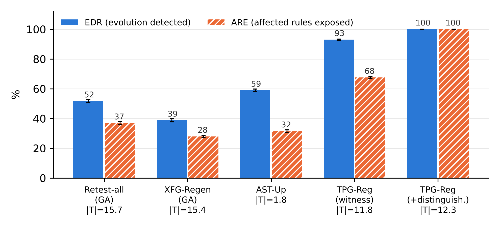

# TPG-Reg — experiment report
All numbers below are produced by the scripts in `experiments/` (see `run_all.sh`). EDR = evolution detection rate, ARE = affected-rule exposure, |T| = tests per evolution; mean over seeds 1–5 (± population SD).

## Benchmark policy sets and TPG sizes

| Set | Rules | Policies | \|D\| | \|V\| | \|E\| | precedes/overrides/refers | Evolutions | Behaviour-changing |
|---|---|---|---|---|---|---|---|---|
| HACS | 25 | 5 | 92160 | 104 | 194 | 3/4/3 | 164 | 126 |
| FMS | 30 | 3 | 172800 | 111 | 278 | 12/63/2 | 172 | 129 |
| SIS | 20 | 4 | 20480 | 83 | 160 | 12/2/1 | 126 | 108 |

## Impact analysis and edge-type ablation (363 behaviour-changing single-edit evolutions)

| Variant | BIS recall % | BIS precision % | Evolutions with missed affected rule | mean \|BIS\| | EDR % | ARE % | \|T\| | Equivalent evolutions with non-empty impact (of 99) |
|---|---|---|---|---|---|---|---|---|
| AST-Up | 35.5 | 59.7 | 188 | 1.7 | 58.9 | 31.5 | 1.8 | 83 |
| TPG-Reg | 100.0 | 27.6 | 0 | 10.1 | 92.9 | 67.5 | 11.8 | 34 |
| -precedes | 87.8 | 32.4 | 64 | 7.6 | 90.1 | 62.3 | 8.6 | 34 |
| -overrides | 63.3 | 46.3 | 145 | 3.8 | 94.0 | 60.7 | 5.5 | 34 |
| -scopes | 98.2 | 27.8 | 8 | 9.9 | 92.9 | 66.2 | 11.5 | 30 |
| -refers | 98.3 | 27.3 | 8 | 10.0 | 90.9 | 66.5 | 11.7 | 34 |

BIS recall per dataset (%):


| Set | AST-Up | TPG-Reg | -precedes | -overrides | -scopes | -refers |
|---|---|---|---|---|---|---|
| HACS | 50.4 | 100.0 | 94.0 | 79.9 | 95.7 | 95.7 |
| FMS | 24.0 | 100.0 | 92.4 | 43.4 | 99.8 | 98.7 |
| SIS | 48.4 | 100.0 | 70.0 | 95.5 | 96.9 | 100.0 |

## Regression detection on single-edit evolutions
Retest-all / XFG-Regen: path-based flow-graph suites of P1 / P2 (one request per rule path), minimised by a genetic algorithm (GA) or greedy set cover. TPG-Reg(raw): witnesses without minimisation.


| Method | HACS EDR % | HACS ARE % | HACS \|T\| | FMS EDR % | FMS ARE % | FMS \|T\| | SIS EDR % | SIS ARE % | SIS \|T\| | ALL EDR % | ALL ARE % | ALL \|T\| |
|---|---|---|---|---|---|---|---|---|---|---|---|---|
| Retest-all(GA) | 66.5±3.3 | 59.3±2.9 | 19.4 | 40.5±1.4 | 26.9±1.4 | 13.9 | 47.8±2.1 | 38.2±1.5 | 13.6 | 51.7±1.1 | 36.9±1.0 | 15.7 |
| Retest-all | 64.3±2.1 | 57.5±1.6 | 18.2 | 41.1±2.5 | 25.3±1.2 | 12.4 | 45.6±3.3 | 38.5±2.9 | 12.8 | 50.5±1.9 | 35.7±0.9 | 14.6 |
| XFG-Regen(GA) | 49.0±2.5 | 41.7±1.7 | 18.9 | 30.1±2.6 | 21.4±1.8 | 13.7 | 37.2±4.1 | 29.9±3.2 | 13.3 | 38.8±1.1 | 27.9±0.7 | 15.4 |
| XFG-Regen | 48.1±2.2 | 42.1±1.2 | 17.9 | 25.6±2.3 | 17.9±1.8 | 12.4 | 30.0±2.5 | 24.9±2.6 | 12.4 | 34.7±1.5 | 25.1±1.6 | 14.3 |
| AST-Up | 67.5±1.3 | 47.4±0.8 | 1.7 | 48.8±1.6 | 21.0±1.3 | 1.9 | 60.9±2.9 | 41.0±2.0 | 1.6 | 58.9±0.8 | 31.5±0.7 | 1.8 |
| Diff-1 | 100.0±0.0 | 68.9±0.8 | 1.0 | 100.0±0.0 | 47.1±0.5 | 1.0 | 100.0±0.0 | 68.0±0.4 | 1.0 | 100.0±0.0 | 56.7±0.4 | 1.0 |
| Diff-k | 100.0±0.0 | 88.4±1.6 | 4.0 | 100.0±0.0 | 93.7±0.7 | 22.1 | 100.0±0.0 | 94.0±0.7 | 10.5 | 100.0±0.0 | 92.5±0.3 | 12.3 |
| Diff-all | 100.0±0.0 | 100.0±0.0 | 1.4 | 100.0±0.0 | 100.0±0.0 | 2.1 | 100.0±0.0 | 100.0±0.0 | 1.5 | 100.0±0.0 | 100.0±0.0 | 1.7 |
| TPG-Reg(cfW1) | 97.8±0.6 | 87.4±0.3 | 3.8 | 87.0±0.9 | 52.3±0.3 | 23.9 | 91.3±0.7 | 76.9±0.7 | 10.0 | 92.0±0.6 | 65.8±0.3 | 12.8 |
| TPG-Reg | 98.3±0.3 | 87.5±0.4 | 3.8 | 85.4±0.8 | 52.1±0.8 | 21.0 | 95.7±0.7 | 84.8±0.3 | 10.3 | 92.9±0.4 | 67.5±0.5 | 11.8 |
| TPG-Reg(raw) | 99.4±0.6 | 97.2±0.9 | 12.1 | 95.3±1.0 | 88.8±1.1 | 133.9 | 99.4±0.7 | 96.2±2.1 | 29.8 | 98.0±0.6 | 92.4±0.8 | 60.7 |
| TPG-Reg+D | 100.0±0.0 | 100.0±0.0 | 4.0 | 100.0±0.0 | 100.0±0.0 | 22.1 | 100.0±0.0 | 100.0±0.0 | 10.5 | 100.0±0.0 | 100.0±0.0 | 12.3 |
| TPG-Reg(D-only) | 100.0±0.0 | 100.0±0.0 | 1.4 | 100.0±0.0 | 100.0±0.0 | 2.1 | 100.0±0.0 | 100.0±0.0 | 1.5 | 100.0±0.0 | 100.0±0.0 | 1.7 |

EDR (%) per edit operator (behaviour-changing evolutions in parentheses):


| Method | CAC (22) | CCF (146) | CRE (71) | PRO (1) | PTC (20) | RAI (17) | RDL (69) | RRO (6) | VDC (11) |
|---|---|---|---|---|---|---|---|---|---|
| Retest-all(GA) | 60.0 | 50.5 | 58.9 | 0.0 | 71.0 | 34.1 | 48.7 | 66.7 | 10.9 |
| Retest-all | 62.7 | 49.6 | 60.6 | 0.0 | 67.0 | 24.7 | 45.8 | 63.3 | 9.1 |
| XFG-Regen(GA) | 70.9 | 32.6 | 61.7 | 0.0 | 58.0 | 71.8 | 8.1 | 63.3 | 5.5 |
| XFG-Regen | 58.2 | 29.2 | 57.2 | 0.0 | 54.0 | 65.9 | 5.8 | 56.7 | 5.5 |
| AST-Up | 12.7 | 61.5 | 79.2 | 0.0 | 24.0 | 80.0 | 60.3 | 83.3 | 0.0 |
| Diff-1 | 100.0 | 100.0 | 100.0 | 100.0 | 100.0 | 100.0 | 100.0 | 100.0 | 100.0 |
| Diff-k | 100.0 | 100.0 | 100.0 | 100.0 | 100.0 | 100.0 | 100.0 | 100.0 | 100.0 |
| Diff-all | 100.0 | 100.0 | 100.0 | 100.0 | 100.0 | 100.0 | 100.0 | 100.0 | 100.0 |
| TPG-Reg(cfW1) | 86.4 | 93.6 | 98.6 | 0.0 | 83.0 | 82.4 | 95.4 | 83.3 | 63.6 |
| TPG-Reg | 93.6 | 92.7 | 98.6 | 0.0 | 81.0 | 87.1 | 96.8 | 83.3 | 78.2 |
| TPG-Reg(raw) | 100.0 | 97.4 | 99.7 | 100.0 | 100.0 | 95.3 | 99.1 | 100.0 | 81.8 |
| TPG-Reg+D | 100.0 | 100.0 | 100.0 | 100.0 | 100.0 | 100.0 | 100.0 | 100.0 | 100.0 |
| TPG-Reg(D-only) | 100.0 | 100.0 | 100.0 | 100.0 | 100.0 | 100.0 | 100.0 | 100.0 | 100.0 |



### Significance tests (paired over behaviour-changing evolutions)

| Comparison | EDR Wilcoxon p | EDR A12 | ARE Wilcoxon p | ARE A12 | McNemar b | McNemar c | McNemar p |
|---|---|---|---|---|---|---|---|
| TPG-Reg vs Retest-all | 4.32e-44 | 0.77 | 1.13e-46 | 0.75 | 156 | 2 | 6.9e-44 |
| TPG-Reg vs XFG-Regen | 1.10e-51 | 0.83 | 5.65e-53 | 0.83 | 222 | 0 | 3.0e-67 |
| TPG-Reg vs Retest-all(GA) | 3.71e-45 | 0.79 | 1.52e-47 | 0.76 | 152 | 1 | 2.7e-44 |
| TPG-Reg vs XFG-Regen(GA) | 1.89e-50 | 0.83 | 7.93e-53 | 0.83 | 204 | 4 | 3.8e-55 |
| TPG-Reg vs AST-Up | 5.19e-39 | 0.74 | 1.56e-41 | 0.71 | 125 | 0 | 4.7e-38 |
| TPG-Reg vs Diff-1 | 9.31e-09 | 0.45 | 3.30e-04 | 0.54 | 0 | 25 | 6.0e-08 |
| TPG-Reg vs Diff-k | 9.31e-09 | 0.45 | 1.18e-13 | 0.44 | 0 | 25 | 6.0e-08 |
| TPG-Reg vs Diff-all | 9.31e-09 | 0.45 | 1.07e-25 | 0.35 | 0 | 25 | 6.0e-08 |
| TPG-Reg+D vs Retest-all | 5.68e-49 | 0.82 | 5.81e-53 | 0.85 | 179 | 0 | 2.6e-54 |
| TPG-Reg+D vs XFG-Regen | 1.21e-56 | 0.87 | 7.90e-60 | 0.91 | 247 | 0 | 8.8e-75 |
| TPG-Reg+D vs Retest-all(GA) | 2.85e-51 | 0.84 | 8.67e-55 | 0.87 | 176 | 0 | 2.1e-53 |
| TPG-Reg+D vs XFG-Regen(GA) | 2.17e-56 | 0.88 | 2.09e-59 | 0.92 | 225 | 0 | 3.7e-68 |
| TPG-Reg+D vs AST-Up | 5.68e-45 | 0.79 | 9.97e-50 | 0.82 | 150 | 0 | 1.4e-45 |
| TPG-Reg+D vs Diff-1 | 1.00e+00 | 0.50 | 2.40e-32 | 0.70 | 0 | 0 | 1.0e+00 |
| TPG-Reg+D vs Diff-k | 1.00e+00 | 0.50 | 3.82e-20 | 0.62 | 0 | 0 | 1.0e+00 |
| TPG-Reg+D vs Diff-all | 1.00e+00 | 0.50 | 1.00e+00 | 0.50 | 0 | 0 | 1.0e+00 |
| TPG-Reg(D-only) vs Retest-all | 5.68e-49 | 0.82 | 5.81e-53 | 0.85 | 179 | 0 | 2.6e-54 |
| TPG-Reg(D-only) vs XFG-Regen | 1.21e-56 | 0.87 | 7.90e-60 | 0.91 | 247 | 0 | 8.8e-75 |
| TPG-Reg(D-only) vs Retest-all(GA) | 2.85e-51 | 0.84 | 8.67e-55 | 0.87 | 176 | 0 | 2.1e-53 |
| TPG-Reg(D-only) vs XFG-Regen(GA) | 2.17e-56 | 0.88 | 2.09e-59 | 0.92 | 225 | 0 | 3.7e-68 |
| TPG-Reg(D-only) vs AST-Up | 5.68e-45 | 0.79 | 9.97e-50 | 0.82 | 150 | 0 | 1.4e-45 |
| TPG-Reg(D-only) vs Diff-1 | 1.00e+00 | 0.50 | 2.40e-32 | 0.70 | 0 | 0 | 1.0e+00 |
| TPG-Reg(D-only) vs Diff-k | 1.00e+00 | 0.50 | 3.82e-20 | 0.62 | 0 | 0 | 1.0e+00 |
| TPG-Reg(D-only) vs Diff-all | 1.00e+00 | 0.50 | 1.00e+00 | 0.50 | 0 | 0 | 1.0e+00 |

## Independent external policies (XPA repository; synthetic evolutions)

| Set | Rules | Policies | \|D\| | precedes/overrides/refers | Evolutions | Behaviour-changing | BIS recall % | BIS precision % |
|---|---|---|---|---|---|---|---|---|
| iTrust | 64 | 1 | 3680 | 0/0/0 | 389 | 320 | 100.0 | 100.0 |
| Pluto | 21 | 1 | 910 | 0/20/0 | 593 | 568 | 100.0 | 59.0 |
| Conference | 15 | 1 | 27 | 0/14/0 | 78 | 60 | 100.0 | 24.4 |
| Fedora | 12 | 1 | 200 | 0/13/0 | 64 | 50 | 100.0 | 39.3 |

Detection on the behaviour-changing external evolutions:


| Method | iTrust EDR % | Pluto EDR % | Conference EDR % | Fedora EDR % | All EDR % | All ARE % | \|T\| |
|---|---|---|---|---|---|---|---|
| Retest-all(GA) | 87.4 | 17.6 | 95.0 | 53.2 | 46.4±0.7 | 38.9±0.7 | 30.7 |
| Retest-all | 100.0 | 18.0 | 95.0 | 53.2 | 50.7±0.6 | 42.0±0.7 | 33.2 |
| XFG-Regen(GA) | 68.2 | 10.9 | 43.3 | 42.4 | 32.8±0.4 | 27.3±0.3 | 30.6 |
| XFG-Regen | 77.8 | 8.0 | 43.3 | 33.2 | 33.8±0.3 | 27.0±0.3 | 33.0 |
| AST-Up | 100.0 | 10.0 | 95.0 | 60.8 | 46.5±0.1 | 34.9±0.2 | 3.6 |
| Diff-1 | 100.0 | 100.0 | 100.0 | 100.0 | 100.0±0.0 | 95.2±0.1 | 1.0 |
| Diff-k | 100.0 | 100.0 | 100.0 | 100.0 | 100.0±0.0 | 99.3±0.1 | 2.4 |
| Diff-all | 100.0 | 100.0 | 100.0 | 100.0 | 100.0±0.0 | 100.0±0.0 | 1.1 |
| TPG-Reg(cfW1) | 100.0 | 100.0 | 98.3 | 100.0 | 99.9±0.0 | 99.7±0.0 | 4.3 |
| TPG-Reg | 100.0 | 100.0 | 98.3 | 99.6 | 99.9±0.0 | 99.7±0.0 | 4.3 |
| TPG-Reg+D | 100.0 | 100.0 | 100.0 | 100.0 | 100.0±0.0 | 100.0±0.0 | 3.8 |
| TPG-Reg(D-only) | 100.0 | 100.0 | 100.0 | 100.0 | 100.0±0.0 | 100.0±0.0 | 1.1 |

Obligations posed per behaviour-changing evolution:


| Set | Obligations TPG-Reg | TPG-Reg+D | TPG-Reg(D-only) | Diff-all |
|---|---|---|---|---|
| iTrust | 4.8 | 5.8 | 1.0 | 64.0 |
| Pluto | 13.4 | 16.8 | 3.4 | 21.0 |
| Conference | 34.6 | 43.5 | 8.9 | 15.0 |
| Fedora | 31.9 | 38.7 | 6.8 | 12.0 |
| ALL | 12.8 | 16.0 | 3.2 | 34.0 |

Authored sets: obligations posed per behaviour-changing evolution and generation time:


| Set | Obligations TPG-Reg | TPG-Reg+D | TPG-Reg(D-only) | Diff-all | gen ms W | gen ms +D |
|---|---|---|---|---|---|---|
| HACS | 12.1 | 15.0 | 2.9 | 25.1 | 2.0 | 2.7 |
| FMS | 134.2 | 154.1 | 19.9 | 30.0 | 21.4 | 31.9 |
| SIS | 29.9 | 36.8 | 6.9 | 20.1 | 1.1 | 1.9 |
| ALL | 60.8 | 70.9 | 10.1 | 25.3 | 8.6 | 12.8 |

## Oracle correctness: path-based oracle vs. decisive witness (exhaustive over the request space)

| Set | Rules | Path-oracle errors per suite | Error rate % | Exact W1: rules with wrong expected decision | Exact W1: rules with non-decisive requests | cf-W1: rules with wrong expected decision | cf-W1: rules with non-decisive requests | Dead rules (exact W1 unsatisfiable) |
|---|---|---|---|---|---|---|---|---|
| HACS | 25 | 2.0 | 8.0 | 0 | 0 | 0 | H.R3 H.R6 | H.R13 |
| FMS | 30 | 5.4 | 18.0 | 0 | 0 | 0 | F.R14 F.R15 F.R17 F.R22 | F.R12 |
| SIS | 20 | 2.8 | 14.0 | 0 | 0 | 0 | S.R6 S.R8 S.R10 S.R12 S.R14 S.R15 S.R20 | - |
| iTrust | 64 | 0.0 | 0.0 | 0 | 0 | 0 | - | - |
| Pluto | 21 | 0.6 | 2.9 | 0 | 0 | 0 | - | - |
| Conference | 15 | 0.2 | 1.3 | 0 | 0 | 0 | - | - |
| Fedora | 12 | 1.4 | 11.7 | 0 | 0 | 0 | - | - |

## Change-aware (intent) oracle on two-edit commits, authored sets (120 clean, 120 with an undeclared edit)

| Method | Clean: false alarm % | Clean: detect % | Dirty: flagged % | Dirty: detect % | Dirty: \|T\| |
|---|---|---|---|---|---|
| Retest-all | 0.0 | 52.2 | 50.2 | 77.3 | 14.5 |
| XFG-Regen | 0.0 | 35.3 | 35.5 | 59.7 | 14.2 |
| AST-Up | 0.0 | 59.5 | 51.8 | 80.3 | 3.2 |
| TPG-Reg | 0.0 | 95.7 | 92.2 | 99.2 | 17.3 |
| TPG-Reg+D | 0.0 | 100.0 | 98.3 | 100.0 | 18.0 |
| TPG-Reg(D-only) | 0.0 | 100.0 | 98.2 | 100.0 | 3.0 |
| Diff-1 | 0.0 | 100.0 | 46.8 | 100.0 | 1.0 |
| Diff-k | 0.0 | 100.0 | 89.2 | 100.0 | 18.0 |
| Diff-all | 0.0 | 100.0 | 97.8 | 100.0 | 3.0 |
| Exhaustive (all requests) | 0.0 | 100 | 99.2 | 100 | - |

## Change-aware (intent) oracle on two-edit commits, external XPA policies (160 clean, 160 with an undeclared edit)

| Method | Clean: false alarm % | Clean: detect % | Dirty: flagged % | Dirty: detect % | Dirty: \|T\| |
|---|---|---|---|---|---|
| Retest-all | 0.0 | 67.4 | 66.4 | 78.6 | 26.8 |
| XFG-Regen | 0.0 | 47.9 | 41.9 | 63.4 | 26.2 |
| AST-Up | 0.0 | 69.2 | 63.0 | 75.9 | 6.1 |
| TPG-Reg | 0.0 | 99.4 | 98.9 | 99.4 | 11.2 |
| TPG-Reg+D | 0.0 | 100.0 | 99.4 | 100.0 | 10.8 |
| TPG-Reg(D-only) | 0.0 | 100.0 | 98.9 | 100.0 | 2.3 |
| Diff-1 | 0.0 | 100.0 | 52.5 | 100.0 | 1.0 |
| Diff-k | 0.0 | 100.0 | 98.9 | 100.0 | 7.6 |
| Diff-all | 0.0 | 100.0 | 98.9 | 100.0 | 2.3 |
| Exhaustive (all requests) | 0.0 | 100 | 99.4 | 100 | - |

## Scalability with the Z3 backend (synthetic policies, integer domains [0, 10^6])

| n | \|E*\| | build s | Z3 queries (build) | evolutions | changed | G2 incr. s (med) | BIS s (med) | \|BIS\| (med) | global diff s (med) | outside-BIS rules queried | UNSAT | UNKNOWN | soundness violations | affected rules (exact) | affected UNKNOWN |
|---|---|---|---|---|---|---|---|---|---|---|---|---|---|---|---|
| 50 | 11 | 0.0 | 15 | 30 | 26 | 0.03 | 0.000 | 1 | 0.012 | 1216 | 1216 | 0 | 0 | 71 | 0 |
| 100 | 73 | 0.1 | 92 | 30 | 24 | 0.06 | 0.000 | 4 | 0.012 | 2157 | 2157 | 0 | 0 | 67 | 0 |
| 200 | 263 | 0.2 | 326 | 30 | 22 | 0.12 | 0.001 | 2 | 0.020 | 3908 | 3908 | 0 | 0 | 50 | 0 |
| 400 | 1683 | 0.8 | 1867 | 30 | 16 | 0.27 | 0.009 | 24 | 0.074 | 3978 | 3978 | 0 | 0 | 97 | 0 |
| 800 | 7621 | 2.4 | 8596 | 30 | 15 | 0.61 | 0.448 | 214 | 0.144 | not run | not run | not run | not run | not run | not run |

End-to-end generation cost and effectiveness on behaviour-changing evolutions (gen = obligation construction + solving + minimisation; Diff-all also includes its per-rule queries):


| n | Method | EDR % | ARE % | \|T\| | solver calls | UNKNOWN | gen s (med) | gen s (mean) |
|---|---|---|---|---|---|---|---|---|
| 50 | TPG-Reg | 88.5 | 90.1 | 5.8 | 20.3 | 0 | 0.04 | 0.09 |
| 50 | TPG-Reg+D | 100.0 | 100.0 | 6.1 | 23.7 | 0 | 0.05 | 0.12 |
| 50 | Diff-1 | 100.0 | 45.1 | 1.0 | 1 | - | 0.00 | 0.00 |
| 50 | Diff-k | 100.0 | 60.6 | 6.1 | 1 | - | 0.01 | 0.01 |
| 50 | TPG-Reg(D-only) | 100.0 | 100.0 | 2.3 | 3.4 | - | 0.01 | 0.02 |
| 50 | Diff-all | 100.0 | 100.0 | 2.3 | 50.2 | - | 0.24 | 0.23 |
| 100 | TPG-Reg | 91.7 | 67.2 | 18.1 | 62.0 | 0 | 0.17 | 0.38 |
| 100 | TPG-Reg+D | 100.0 | 100.0 | 18.8 | 72.2 | 0 | 0.22 | 0.46 |
| 100 | Diff-1 | 100.0 | 44.8 | 1.0 | 1 | - | 0.01 | 0.01 |
| 100 | Diff-k | 100.0 | 70.1 | 18.8 | 1 | - | 0.02 | 0.04 |
| 100 | TPG-Reg(D-only) | 100.0 | 100.0 | 2.2 | 10.2 | - | 0.05 | 0.09 |
| 100 | Diff-all | 100.0 | 100.0 | 2.2 | 100.0 | - | 0.84 | 0.86 |
| 200 | TPG-Reg | 100.0 | 88.0 | 32.8 | 109.9 | 0 | 0.12 | 0.72 |
| 200 | TPG-Reg+D | 100.0 | 100.0 | 32.9 | 132.3 | 0 | 0.26 | 1.15 |
| 200 | Diff-1 | 100.0 | 64.0 | 1.0 | 1 | - | 0.01 | 0.01 |
| 200 | Diff-k | 100.0 | 92.0 | 32.9 | 1 | - | 0.03 | 0.07 |
| 200 | TPG-Reg(D-only) | 100.0 | 100.0 | 1.6 | 22.4 | - | 0.09 | 0.38 |
| 200 | Diff-all | 100.0 | 100.0 | 1.6 | 200.0 | - | 3.63 | 3.62 |
| 400 | TPG-Reg | 68.8 | 33.0 | 238.7 | 846.7 | 0 | 5.18 | 7.54 |
| 400 | TPG-Reg+D | 100.0 | 100.0 | 242.4 | 998.1 | 0 | 7.84 | 10.84 |
| 400 | Diff-1 | 100.0 | 24.7 | 1.0 | 1 | - | 0.01 | 0.02 |
| 400 | Diff-k | 100.0 | 46.4 | 242.4 | 1 | - | 0.33 | 0.62 |
| 400 | TPG-Reg(D-only) | 100.0 | 100.0 | 4.3 | 151.4 | - | 2.55 | 2.83 |
| 400 | Diff-all | 100.0 | 100.0 | 4.3 | 400.0 | - | 7.37 | 7.42 |

## External policy GPMS (XPA repository) with the Z3 backend

| n | \|E*\| | build s | Z3 queries (build) | evolutions | changed | G2 incr. s (med) | BIS s (med) | \|BIS\| (med) | global diff s (med) | outside-BIS rules queried | UNSAT | UNKNOWN | soundness violations | affected rules (exact) | affected UNKNOWN |
|---|---|---|---|---|---|---|---|---|---|---|---|---|---|---|---|
| GPMS | 57 | 0.2 | 861 | 100 | 92 | 0.23 | 0.001 | 3 | 0.019 | 8435 | 8435 | 0 | 0 | 162 | 0 |

End-to-end generation cost and effectiveness on behaviour-changing evolutions (gen = obligation construction + solving + minimisation; Diff-all also includes its per-rule queries):


| n | Method | EDR % | ARE % | \|T\| | solver calls | UNKNOWN | gen s (med) | gen s (mean) |
|---|---|---|---|---|---|---|---|---|
| GPMS | TPG-Reg | 73.9 | 63.0 | 10.2 | 29.0 | 0 | 0.20 | 0.35 |
| GPMS | TPG-Reg+D | 100.0 | 100.0 | 10.2 | 34.3 | 0 | 0.29 | 0.40 |
| GPMS | Diff-1 | 100.0 | 74.7 | 1.0 | 1 | - | 0.01 | 0.01 |
| GPMS | Diff-k | 100.0 | 81.5 | 10.2 | 1 | - | 0.03 | 0.04 |
| GPMS | TPG-Reg(D-only) | 100.0 | 100.0 | 1.3 | 5.3 | - | 0.03 | 0.04 |
| GPMS | Diff-all | 100.0 | 100.0 | 1.3 | 97.0 | - | 0.66 | 0.66 |

## Validation

Prototype PDP vs. independent XACML PDP (ndg-xacml):


| Set | Policy versions | Requests evaluated | Mismatches vs ndg-xacml | Exhaustive original requests |
|---|---|---|---|---|
| FIN | 4 | 336 | 0 |  |
| HACS | 165 | 186688 | 0 | 92160 |
| FMS | 173 | 271700 | 0 | 172800 |
| SIS | 127 | 93832 | 0 | 20480 |

Z3 backend vs. enumeration backend:


| Set | Versions | Edge sets identical (Z3 vs enumeration) | Z3 queries | Pre-filtered pairs | Valid Z3 witnesses |
|---|---|---|---|---|---|
| HACS | 165 | 165 | 2081 | 22504 | 424/424 |
| FMS | 173 | 173 | 20499 | 17871 | 533/533 |
| SIS | 127 | 127 | 3439 | 8641 | 257/257 |

## Financial example (Commit A: refine R2, Commit B: refactoring)

```
path-based oracle for R1 at amount=7: expected Permit, PDP: Deny
v1 edges: [('overrides', 'R:M.R1', 'R:M.R2')]
W1(R1) amounts: [0, 1, 2, 3, 4, 5]

Commit A (refine R2: 5->8): CH=['M.R2'] BIS=['M.R1', 'M.R2'] |diff|=3 suite=4
  amount= 6: Deny -> Permit  decisive=['M.R1', 'M.R2']  => intended
  ground-truth changed amounts: [6, 7, 8]

Commit B (refactor: DO->FA): CH=['M.R1', 'M.R2'] BIS=['M.R1', 'M.R2'] |diff|=4 suite=3
  amount= 6: Deny -> Permit  decisive=['M.R1', 'M.R2']  => REGRESSION
  ground-truth changed amounts: [6, 7, 8, 9]
```

## Result files
- `tables/*.csv` — every table above
- `single_edit_evolution/` — `per_evolution_<SET>.json` (per evolution and seed), `policy_statistics.json`, `summary.json`, `significance_tests.json`, `detection_rates.png`
- `two_edit_commits/` — `per_commit.json`, `summary.json`
- `scalability/` — `runs_full_pipeline_n*.json`, `runs_analysis_only_n*.json`
- `validation/` — `pdp_conformance.json`, `smt_backend_equivalence.json`
- `regression_suites/` — `<SET>_regression_tests.csv` (requests, decisions of both versions, decisive rules) and `<SET>_impact_sets.csv` for every evolution
- `xacml_policies/` — policy sets and financial-example versions as XACML 2.0 XML
- `finance_example/output.txt` — output of the financial example
- `logs/` — console output of every step
